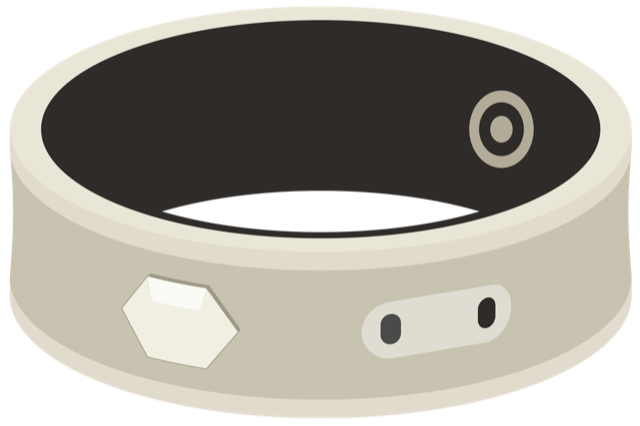
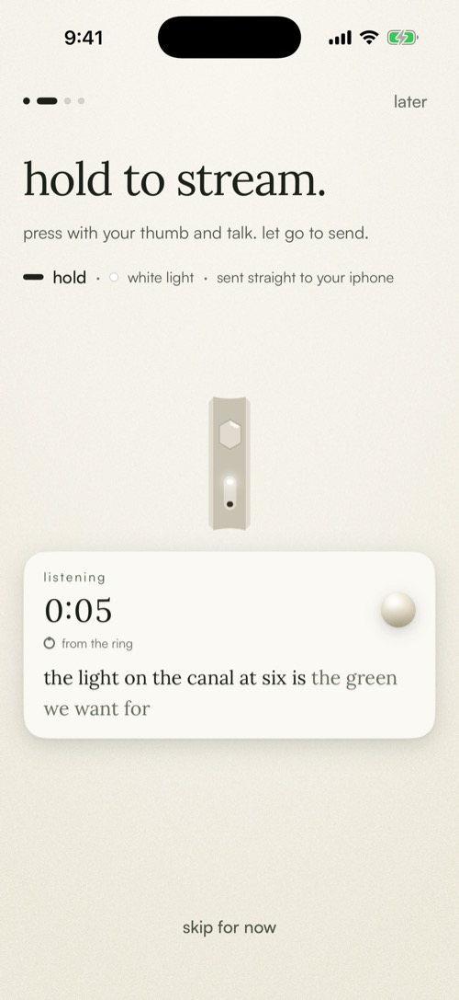
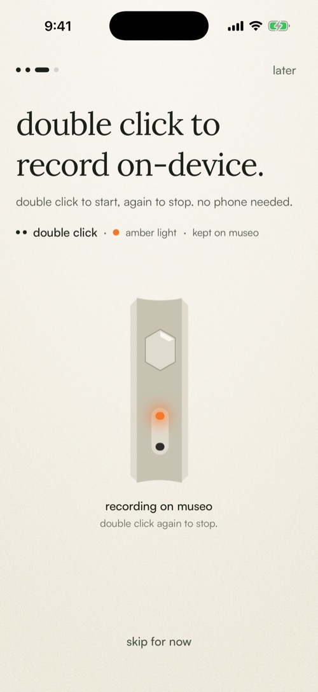
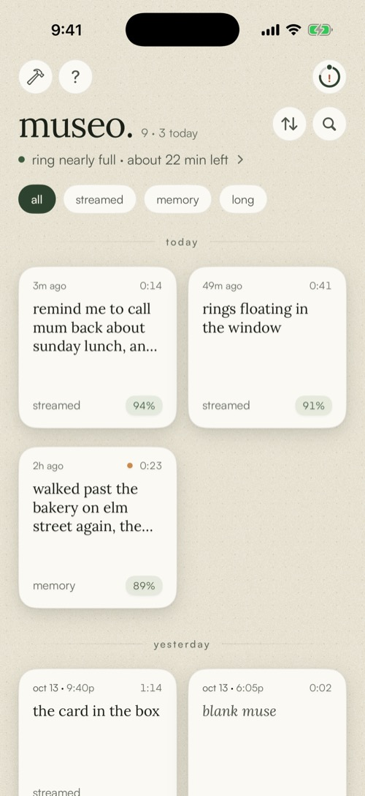
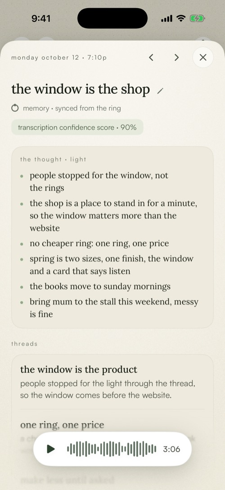
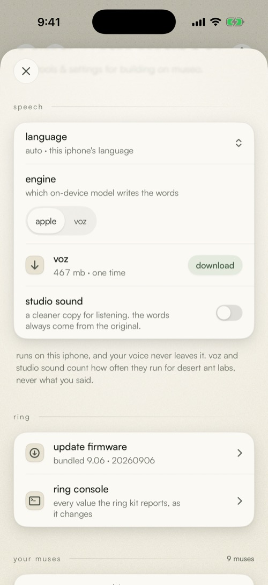
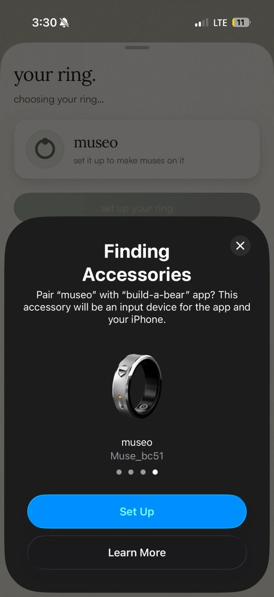

<p align="center">
  
</p>

<h1 align="center">museo build-a-bear</h1>

<p align="center"><i>a new interface for your thoughts.</i></p>

<p align="center">an open starting point to build anything on museo.</p>

<p align="center">
  
  
  
</p>

<p align="center"><b><a href="#the-builders-path">start in 5 minutes</a> · <a href="#tips">tips</a> · <a href="#two-asks-until-launch">two asks</a></b></p>

> [!IMPORTANT]
> **preview.** museo build is out ahead of its launch. two small asks [below](#two-asks-until-launch).

## your baseline to build on

the ring sets up, what you say lands on your iphone as words, gets a title and notes, and stays in a library. all of it runs on the phone. you build what comes next.

<table>
  <tr>
    <td width="33%" valign="top">
      <br>
      <b>streaming</b><br>hold the ring and talk. words appear as you speak.<br>
      <a href="museo%20build/Screens/Home/">Screens/Home →</a>
    </td>
    <td width="33%" valign="top">
      <br>
      <b>memory</b><br>double click to record on the ring. it comes in later.<br>
      <a href="museo%20build/Engine/Pipeline/">Engine/Pipeline →</a>
    </td>
    <td width="33%" valign="top">
      <br>
      <b>the library</b><br>every muse, by day.<br>
      <a href="museo%20build/Screens/Home/">Screens/Home →</a>
    </td>
  </tr>
  <tr>
    <td width="33%" valign="top">
      <br>
      <b>auto-notes</b><br>titles and notes, written on the iphone.<br>
      <a href="museo%20build/Engine/AI/">Engine/AI →</a>
    </td>
    <td width="33%" valign="top">
      <br>
      <b>audio + transcription</b><br>basic settings to use as they are, or customize.<br>
      <a href="museo%20build/Engine/Speech/">Engine/Speech →</a>
    </td>
    <td width="33%" valign="top">
      <br>
      <b>your ring</b><br>set up with iOS's own sheet. no pairing codes.<br>
      <a href="museo%20build/Screens/Ring/">Screens/Ring →</a>
    </td>
  </tr>
</table>

## the builder's path

1. **clone it.** one repo: Xcode fetches [museo kit](https://github.com/its4ff/museo-kit), the ring's package, on its own.

   ```bash
   git clone https://github.com/its4ff/museo-build-a-bear.git
   ```

2. **open it in Xcode 26.4 or newer** and run.
3. **make it yours** in `Config/Local.xcconfig`: team, bundle id, name.
4. **pick where muses live:** on the phone, or your own backend from [`App/YourCode.swift`](museo%20build/App/YourCode.swift).
5. **vibe code it** in Claude Code or Cursor. [`AGENTS.md`](AGENTS.md) keeps your agent off the ring and the firmware.
6. **build anything** you can imagine.

## tips

- **one backend, many apps.** send your muses to a backend like convex, so every app you try starts full.
- **keep a clean baseline.** one untouched clone. copy it for each idea, until one sticks.
- **one ring, one app.** remove the ring from the old app before you switch.
- **the ring lives on iphone.** for a mac app, read your muses from your backend.

> [!TIP]
> this is how naveed landed on a daily museo: two rings, one paired with [museum](https://4ff.com/museum), one with a co-creator edition that turns walks into projects.

## two asks, until launch

1. please don't post about this repo yet.
2. please don't fork or copy it yet.

made something you love? show naveed at [x.com/naveedg](https://x.com/naveedg), then share it anywhere.

## more

<details>
<summary><b>what you need</b></summary>

| | |
|---|---|
| **to try it** | a Mac with Xcode 26.4 or newer. the simulator runs everything but the ring. |
| **for the ring** | a museo ring and an iphone on iOS 26 or newer. |
| **for titles and notes** | Apple Intelligence turned on (iphone 15 Pro or newer). without it, muses still get their words. |
| **an Apple account** | a free one works on your own iphone, but the app stops opening after 7 days until you run it from Xcode again. a paid developer account lasts a year and adds TestFlight. |

</details>

<details>
<summary><b>your first code</b></summary>

open [`museo build/App/YourCode.swift`](museo%20build/App/YourCode.swift). it already has this:

```swift
MuseHooks.onTranscribed { muse in
    print("[muse][yours] \(muse.origin.label): \(muse.words)")
}
```

run, hold your ring and say "hello there". the line shows in Xcode's console. no ring? `MusePipeline.shared.addTyped("hello there")` makes a muse from code, through the same hooks. the same file has examples for notes landing, ring events, deletes, and sending muses to your own server once the person turns it on.

a screen of your own reads the muses from the environment:

```swift
struct MyScreen: View {
    @Environment(MuseStore.self) private var store
    var body: some View {
        List(store.muses) { muse in Text(muse.displayTitle) }
    }
}
```

</details>

<details>
<summary><b>on your iphone, with your ring</b></summary>

1. **make it yours.** put your team id, a bundle id that's yours (like `com.yourname.museo`) and the name under the icon in `Config/Local.xcconfig`. git ignores it.
2. **turn on Developer Mode:** Settings › Privacy & Security › Developer Mode, then restart. without it, Xcode can't install the app.
3. **move your ring over.** bring in everything waiting in the old app, then remove the ring there.
4. **run on the iphone** and tap **set up your ring**. can't find it? click the ring 6 times so it forgets its old phone.
5. **hold the ring**, say "hello there", let go.

</details>

<details>
<summary><b>ideas to ask your agent for</b></summary>

- "a today screen: just today's muses, as a timeline"
- "pull the to-dos out of every muse's notes into a list i can check off"
- "a widget with the title of my latest muse"
- "send each muse to my convex backend, behind a switch in build"
- "make the home one column, with bigger tiles"

the agent can check its own work: `scripts/build.sh` builds and prints "build ok" or the errors, and `scripts/lab.sh build-shot [ids]` screenshots mock screens into `lab-shots/`.

</details>

<details>
<summary><b>what doesn't work yet</b></summary>

- the simulator has no bluetooth, so the ring needs a real iphone.
- ring setup is iphone only. a mac app reads your muses from your backend.
- titles and notes need Apple Intelligence.

</details>

<details>
<summary><b>how it's laid out</b></summary>

| layer | where | what it means |
|---|---|---|
| **sealed: the ring** | [museo kit](https://github.com/its4ff/museo-kit), the `MuseoKit` package Xcode fetches | bluetooth, sync, setup and firmware. you `import MuseoKit` and never edit it, so you (and your agent) can't break the ring. |
| **stable: capture** | `Engine/`, `Model/`, `LiveActivity/` | the pipeline, speech, titles and notes, search. it works; change it when you know why. |
| **yours** | `App/`, `Screens/`, `Design/` | the screens, the look, `YourCode.swift`. change or delete anything. |

| folder | what's there |
|---|---|
| `museo build/` | the app. |
| `museo build widget/` | the Live Activity on the lock screen. |
| `Config/` | `Builder.xcconfig` (your team, bundle id and name) and `Info.plist`. |
| `Shared/` | what the app and the widget share, and the fonts. |
| `docs/` | [the ring in plain words](docs/ring.md) and [the cheat sheet](docs/cheat-sheet.md). |
| `scripts/` | build and screenshot from the command line. |

</details>

<details>
<summary><b>staying up to date</b></summary>

`git pull`. updates mostly touch `Engine/`, `Model/` and the docs, and your work mostly lives in `App/` and `Screens/`, so they rarely collide. museo kit updates come with it: Xcode fetches the version this repo pins.

</details>

<details>
<summary><b>credits and licenses</b></summary>

museo build is in preview. no license yet, so all rights reserved. a license comes with the launch.

- **Lora** by Cyreal (`Shared/Lora-Variable.ttf`, `museo build/Design/Fonts/Lora-Italic.ttf`), under the SIL Open Font License 1.1.
- **Satoshi** by the Indian Type Foundry (`Shared/Satoshi-Variable.ttf`), from Fontshare under the ITF Free Font License. free to use in apps, and its terms ask you to credit ITF by name. read them at [fontshare.com/terms](https://www.fontshare.com/terms) before you publish anything that includes the font file. if in doubt, swap the face in `museo build/Design/MuseFont.swift`.
- **Voz and Clear** by Desert Ant Labs (desert-ant-core 3.5.0): the optional Voz speech engine and studio sound, under the Desert Ant Labs Source-Available License 1.0 ([license.desertant.com/1.0](https://license.desertant.com/1.0)). free below 100,000 monthly active devices per platform for each model, attribution required (build › about credits them, so keep that line), and no using the models or their output to train a competing model. neither ships in the app: each downloads the first time it's used (build › speech).
  - **what it sends:** while Voz or studio sound runs, and only then, desert-ant-core sends Desert Ant an anonymous install id, how often each model ran, and diagnostics. never audio or words. `SpeechEngine.keepUsageAnonymous()` already drops the device model, OS and locale; `DesertAnt.usageDisabled = true` turns it off, if their licence allows it for you. put it on your App Store privacy label.
- **firmware updates** (inside museo kit) use Nordic Semiconductor's nRF Connect Device Manager (Apache 2.0) with ZIPFoundation (MIT) and SwiftCBOR (Unlicense).
- speech recognition and the on-device model are Apple's (Speech, FoundationModels).

</details>

<br>

<p align="center">made by 4ff · tech built 4 friends &amp; family.</p>
