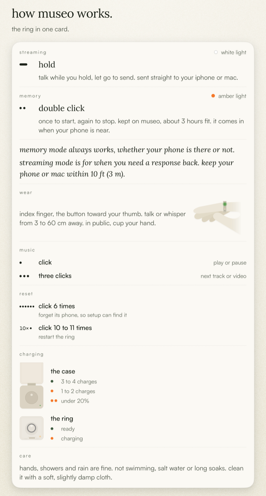

# museo cheat sheet

## streaming · hold

- talk while you hold, let go to send.
- white light.
- sent straight to your iphone or mac.

## memory · double click

- once to start, again to stop.
- amber light.
- kept on museo, about 3 hours fit.
- comes in when your phone is near.

**memory mode always works, whether your phone is there or not. streaming mode is for when you need a response back: keep your phone or mac within 10 ft (3 m).**

## wear

- index finger, the button toward your thumb.
- talk or whisper from 3 to 60 cm away. in public, cup your hand.

## music

- click · play or pause.
- three clicks · next track or video.

## reset

- click 6 times · forget its phone, so setup can find it.
- click 10 to 11 times · restart the ring.

## charging

- the case's light: green · 3 to 4 charges. amber · 1 to 2. two amber · under 20%.
- the ring in the case: green · ready. amber · charging.

## care

- hands, showers and rain are fine. not swimming, salt water or long soaks.
- clean it with a soft, slightly damp cloth.

More about the ring, for builders: [`ring.md`](ring.md).
